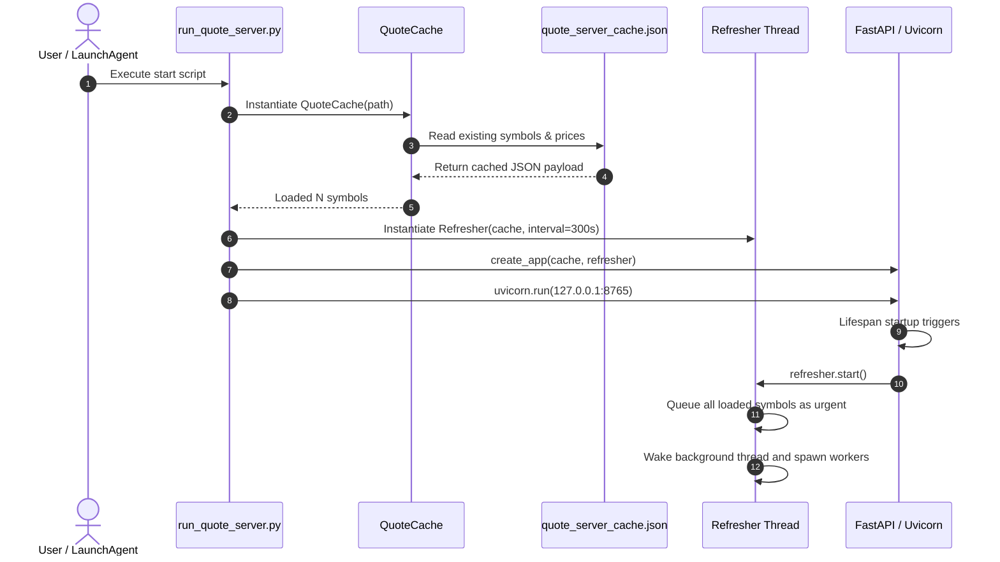
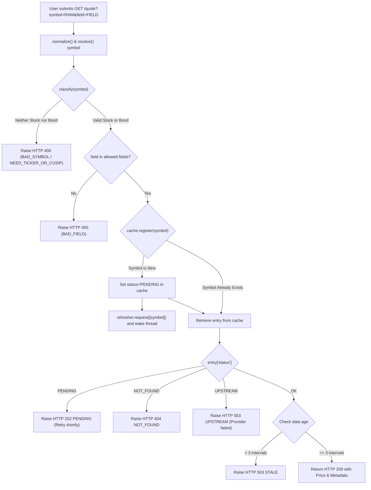
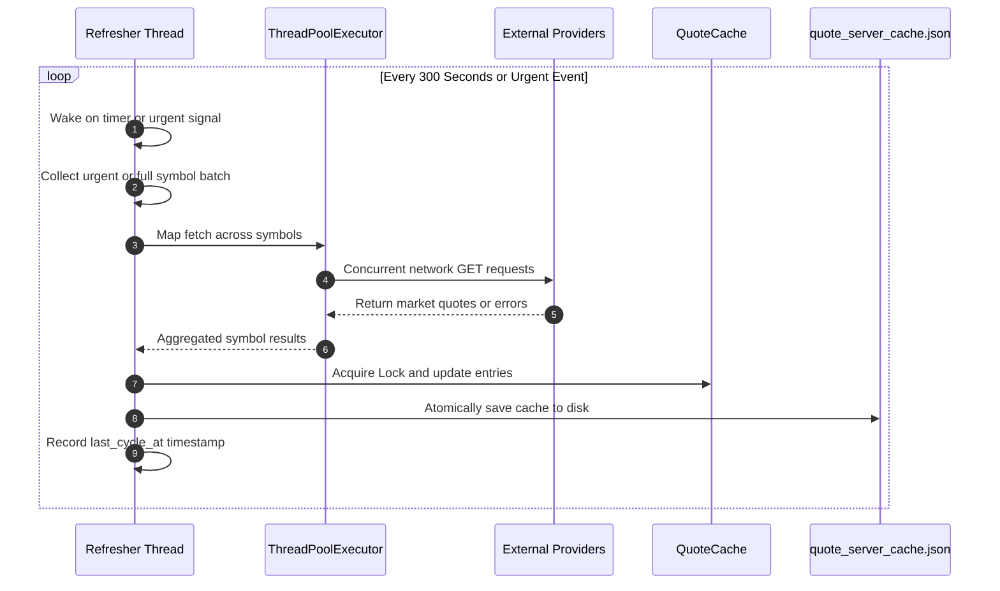

# Quote Server Engineering Guide

## 1. High-Level Overview

### 1.1 Purpose & Business Context
Quote Server is a lightweight, local HTTP microservice designed to bridge live financial market data into local analytical tools, specifically spreadsheets (such as LibreOffice Calc) and automated financial analysis scripts.

In quantitative financial analysis, spreadsheets frequently require current asset pricing to calculate portfolio valuations, yield metrics, risk exposures, and asset allocations. Standard approaches to fetching online market data directly inside spreadsheets suffer from significant drawbacks:
- Direct cell lookups stall spreadsheet user interfaces while waiting for slow internet requests.
- External financial APIs impose strict rate limits or prohibitively expensive enterprise subscription fees.
- Spreadsheet functions often lack support for specialized asset classes, such as fixed-income US Treasury bonds identified by CUSIP numbers.

Quote Server eliminates these limitations through an **in-memory caching architecture**:
1. **Zero Latency**: Every incoming pricing request is answered instantaneously from local computer memory (typically in under one millisecond).
2. **Asynchronous Ingestion**: Market data fetching occurs in the background across separate background worker threads. The user interface never freezes waiting for an external website or network request.
3. **Multi-Asset Coverage**: Supports equity tickers (stocks, ETFs, market indices) via Yahoo Finance and US Treasury bonds (prices, yields to worst, and maturities) via Webull bond streams.
4. **Resilient Local Persistence**: Known symbols and last-fetched quotes persist to a local file on disk, enabling seamless recovery across restarts.

### 1.2 Tech Stack Breakdown
The application uses a minimalist, modern Python stack designed for execution on local machines without requiring external database servers or heavy container runtimes.

| Layer | Technology | Beginner-Friendly Explanation | Role in Quote Server |
|---|---|---|---|
| **Programming Language** | Python 3.10+ | A readable, high-level programming language that emphasizes developer productivity and clean syntax. | Powers all core application logic, parsing, background workers, and automation scripts. |
| **Web Framework** | FastAPI | A modern, high-performance web framework designed for building REST APIs with Python type declarations. | Defines HTTP endpoints (`/quote`, `/batch-refresh`, `/refresh-all`, `/health`), validates input queries, and produces JSON responses. |
| **ASGI Web Server** | Uvicorn | A fast web server implementation that translates network traffic between the operating system and Python applications. | Listens on the local loopback network interface (`127.0.0.1:8765`) and directs incoming HTTP requests into FastAPI. |
| **Data Validation** | Pydantic | A data modeling and validation library that enforces data structure and type constraints in Python. | Parses and validates JSON request bodies submitted to batch endpoints, enforcing batch size limits. |
| **Concurrency & Workers** | Python Standard Threading (`threading`, `concurrent.futures`) | Built-in language tools that allow multiple tasks to execute simultaneously within a single operating system process. | Runs background data refresh loops and parallelizes external web queries across 8 concurrent worker threads. |
| **Market Data Providers** | `yfinance` & `requests` | Specialized networking packages used to retrieve data from external web servers. | Downloads equity prices from Yahoo Finance and scrapes Treasury bond pricing data from Webull public pages. |
| **Data Storage / Persistence** | Atomic JSON File (`tempfile`, `os.replace`, `json`) | Plaintext JSON stored on the local filesystem, written atomically using temporary files. | Acts as the embedded database for the application, preserving known symbols and last-known prices across server restarts. |
| **Client Integration** | LibreOffice Basic & Python UNO Bridge | Built-in spreadsheet scripting languages and automation protocols. | Implements the custom `=GETQUOTE()` formula and adds native menu bars and toolbar buttons to LibreOffice Calc. |
| **Process Supervision** | macOS LaunchAgent (`launchd`) | macOS's native service supervisor that manages background system services. | Starts Quote Server automatically on user login and restarts the process if it terminates unexpectedly. |

---

## 2. Component Inventory & Architecture

### 2.1 Repository Structure
All Quote Server components reside under the `quote_server/` directory within the financial analytics workspace:

```
quote_server/
├── __init__.py                     # Package definition exposing version information
├── app.py                          # FastAPI application, route handlers, error mappings
├── cache.py                        # In-memory thread-safe cache with atomic disk persistence
├── providers.py                    # External market data providers (yfinance & Webull)
├── refresher.py                    # Background thread managing scheduled and urgent fetches
├── symbols.py                      # Ticker and CUSIP parsing, normalization, and validation
├── docs/                           # Technical documentation and engineering guides
│   └── engineering_guide.md
├── libreoffice/                    # Client integration files for LibreOffice Calc
│   ├── __init__.py
│   ├── QuoteServer.bas             # LibreOffice Basic macro defining =GETQUOTE()
│   ├── calc_quote_client.py        # Python client script bridging Calc to HTTP API
│   └── extension/                  # Calc UI extension (Menus, Toolbars, Event listeners)
└── scripts/                        # Management, setup, and installation scripts
    ├── install_calc_integration.py # Installs Basic macros, scripts, and Calc UI extension
    ├── install_launch_agent.py     # Installs macOS launchd LaunchAgent for autostart
    ├── run_quote_server.py         # Main executable Python entry point
    ├── setup.sh                    # Environment bootstrapper (creates venv and installs deps)
    └── start_quote_server.sh       # Convenience shell script to launch the server
```

### 2.2 Deep-Dive: Core Libraries & Architectural Components
To understand how Quote Server operates, each architectural piece and external library is detailed below across four fundamental aspects: definition, functional role, specific application purpose, and interaction points.

#### 1. FastAPI
- **What it is**: A modern, high-performance web framework for Python designed for creating application programming interfaces (APIs).
- **What it does**: It routes HTTP network requests (like `GET` and `POST`) to designated Python functions, validates incoming query parameters, formats output data into JSON, and handles HTTP error responses.
- **Why it is used here**: Quote Server needs to communicate with local spreadsheets and shell scripts over standard HTTP. FastAPI provides a clean, declarative routing structure, native asynchronous lifespan support, and standardized JSON error structures with minimal boilerplate.
- **How it interacts**: Configured in `quote_server/app.py` via `create_app()`. It receives requests from Uvicorn, queries the `QuoteCache`, requests fetches from `Refresher`, and returns structured JSON responses.

#### 2. Uvicorn (ASGI Web Server)
- **What it is**: An Asynchronous Server Gateway Interface (ASGI) web server implementation for Python.
- **What it does**: It binds to local TCP network sockets, listens for incoming HTTP connections from the operating system, parses HTTP protocol bytes into standardized Python dictionaries, and passes them to ASGI frameworks like FastAPI.
- **Why it is used here**: Frameworks like FastAPI do not include a built-in production socket server. Uvicorn serves as the runtime host that allows FastAPI to run on the local loopback address (`127.0.0.1:8765`).
- **How it interacts**: Instantiated in `quote_server/scripts/run_quote_server.py`. It wraps the FastAPI `app` object produced by `create_app()` and manages network connection lifecycles.

#### 3. Pydantic (`BaseModel`, `Field`)
- **What it is**: A data modeling, parsing, and type-validation library for Python.
- **What it does**: It converts raw dictionaries or JSON payloads into strongly typed Python objects, ensuring fields meet defined rules (e.g., maximum list lengths, allowed data types, default values).
- **Why it is used here**: When spreadsheets send bulk requests to `/batch-refresh`, Pydantic validates that the input contains a valid list of symbols (capping the batch at 500 symbols) and ensures the requested pricing field defaults to `"price"`.
- **How it interacts**: Defined in `quote_server/app.py` as `BatchRequest`. FastAPI automatically applies this model to parse and validate incoming JSON payloads in `batch_refresh()`.

#### 4. Python Threading & Concurrency (`threading.Thread`, `threading.Lock`, `threading.Event`)
- **What it is**: The standard concurrency primitives provided by Python's standard library.
- **What it does**: 
  - `Thread`: Runs instructions independently and concurrently alongside the main execution path.
  - `Lock` (Mutex): Enforces mutual exclusion, ensuring only one thread can access or modify shared variables at a single moment.
  - `Event`: Provides a signaling mechanism allowing threads to pause and wait until another thread signals them to resume.
- **Why it is used here**: Quote Server must satisfy two competing demands: serving client read requests with sub-millisecond latency while simultaneously fetching slow external market data over the internet.
  - `threading.Lock` protects `QuoteCache` so concurrent reads by FastAPI never clash with background writes by fetch workers.
  - `threading.Event` allows the `Refresher` background loop to sleep for 300 seconds without wasting CPU cycles, while waking up instantly when a new symbol is registered.
- **How it interacts**: Found throughout `quote_server/cache.py` (guarding `_entries` dictionary access) and `quote_server/refresher.py` (managing background loop scheduling and urgent wakes).

#### 5. ThreadPoolExecutor (`concurrent.futures`)
- **What it is**: A high-level interface from Python's standard library for managing a pool of pre-allocated worker threads.
- **What it does**: It takes an iterable collection of tasks and distributes them across a fixed number of worker threads to execute in parallel.
- **Why it is used here**: External HTTP network calls to Yahoo Finance and Webull have latency (often 200ms to 1,000ms each). If 50 symbols were refreshed sequentially, the refresh cycle would take nearly a minute. With `ThreadPoolExecutor(max_workers=8)`, 8 symbols are retrieved concurrently, reducing total refresh duration by up to 85%.
- **How it interacts**: Used in `quote_server/providers.py` inside `fetch_many()` to parallelize calls to `fetch_stock()` and `fetch_bond()`.

#### 6. yfinance
- **What it is**: An open-source Python library that fetches market data from Yahoo Finance.
- **What it does**: It abstracts Yahoo Finance's web endpoints, downloading real-time quotes, summary statistics, and historical pricing for global equities, ETFs, and market indices.
- **Why it is used here**: It provides a reliable, zero-cost source for equity pricing (e.g., `AAPL`, `MSFT`, `^GSPC`, `7203.T`) without requiring API keys or user authentication.
- **How it interacts**: Called within `quote_server/providers.py` in `fetch_stock()`. The server queries `yfinance.Ticker(symbol).fast_info["last_price"]` to extract the most recent traded price.

#### 7. Webull Treasury Fetcher (`core.webull_bond_fetcher`)
- **What it is**: A proprietary internal module within the financial analytics platform that fetches live US Treasury bond market quotes.
- **What it does**: It connects to Webull's public quote pages, extracts embedded server-rendered JSON state data (`window.__initState__`), and extracts real-time institutional prices, yields to worst (YTW), and maturity dates.
- **Why it is used here**: Standard financial libraries (including `yfinance`) do not offer individual US Treasury bond pricing by 9-character CUSIP. Webull provides high-fidelity, live Treasury pricing and yield snapshots.
- **How it interacts**: Called in `quote_server/providers.py` within `fetch_bond()`. The returned data is converted into clean pricing, yield, and maturity fields stored in `QuoteCache`.

#### 8. Atomic Disk Persistence (`tempfile`, `os.replace`, `json`)
- **What it is**: A design pattern using standard operating system file operations to guarantee that file writes either complete fully or not at all.
- **What it does**: Instead of writing directly to the target file (`data/quote_server_cache.json`), data is written to a unique temporary file (`tempfile.mkstemp()`). Once the write finishes and the file is flushed to disk, `os.replace()` atomically swaps the temporary file into place.
- **Why it is used here**: Prevents data corruption. If the computer crashes or power is lost mid-write, the existing cache file remains completely intact and readable.
- **How it interacts**: Implemented in `QuoteCache.save()` and `QuoteCache.load()` inside `quote_server/cache.py`.

#### 9. LibreOffice Basic & Python Client Bridge
- **What it is**: LibreOffice's native macro automation system (Basic) combined with its internal Python interpreter (Universal Network Objects / UNO runtime).
- **What it does**: Basic exposes custom spreadsheet functions directly to Calc formulas, while the embedded Python runtime executes system-level networking tasks.
- **Why it is used here**: Calc cells cannot make direct HTTP requests natively. When a user enters `=GETQUOTE("AAPL")`, Calc calls `QuoteServer.bas`, which delegates through LibreOffice's script URI mechanism to `calc_quote_client.py`. The Python script makes a local HTTP call to Quote Server and returns the price back into the spreadsheet cell.
- **How it interacts**: Files in `quote_server/libreoffice/` are linked and registered into LibreOffice's user profile by `install_calc_integration.py`.

#### 10. macOS LaunchAgent (`launchd`)
- **What it is**: The native service management framework on macOS responsible for launching and supervising background daemons.
- **What it does**: Reads property list configuration files (`.plist`) located in `~/Library/LaunchAgents/` and ensures specified background tasks run at user login and remain alive.
- **Why it is used here**: Eliminates the need for users to manually open a terminal and run startup commands every time they log in or restart their computer.
- **How it interacts**: Managed by `quote_server/scripts/install_launch_agent.py`, which generates and loads `com.<user>.quoteserver.plist` pointing to `quote_server/scripts/run_quote_server.py`.

### 2.3 Cache Characteristics, Lifecycle & Storage Architecture

The cache (`QuoteCache` in `quote_server/cache.py`) is the central state holder for Quote Server. It manages in-memory data access, concurrency synchronization, staleness tracking, and persistence to disk.

#### 1. In-Memory Data Model (Cache Entry Schema)
Cache entries are stored in a private Python dictionary (`_entries`) guarded by a `threading.Lock()` mutex. Each tracked symbol maps to a state record:

```json
{
  "AAPL": {
    "kind": "stock",
    "status": "OK",
    "fields": {
      "price": 343.91
    },
    "fetched_at": 1793000123.45,
    "failures": 0,
    "error": null
  },
  "912810UF3": {
    "kind": "bond",
    "status": "OK",
    "fields": {
      "price": 91.82,
      "term": 4.25,
      "ytw": 5.364
    },
    "fetched_at": 1793000125.10,
    "failures": 0,
    "error": null
  }
}
```

| Field | Type | Description |
|---|---|---|
| `kind` | `str` | Asset classification: `"stock"` or `"bond"`. |
| `status` | `str` | Current lifecycle state: `"PENDING"`, `"OK"`, `"NOT_FOUND"`, or `"UPSTREAM"`. |
| `fields` | `dict` | Key-value mapping of market data fields (`price`, `ytw`, `term`). Empty while pending or not found. |
| `fetched_at` | `float \| null` | UNIX epoch timestamp of the last successful fetch. `null` if never successfully retrieved. |
| `failures` | `int` | Count of consecutive upstream fetch failures since the last successful quote. |
| `error` | `str \| null` | Error message string from the most recent failed fetch attempt. |

#### 2. Eviction Policy, TTL, and Staleness Windows
Unlike traditional web caches (e.g., Redis LRU eviction), Quote Server **does not evict or purge symbols by time-to-live (TTL)**. Once a symbol is registered, it remains in memory and is continuously polled on each refresh cycle.

Freshness is governed by **staleness and expiration multipliers** relative to the configured refresh interval ($T = \text{REFRESH\_SECONDS}$, default 300 seconds):

```
0s                  1.5 * T (450s)               3.0 * T (900s)
|--- FRESH (OK) -------|------- STALE (OK) ------------|------- EXPIRED (ERROR) --->
  HTTP 200               HTTP 200                        HTTP 503 (STALE)
  stale: false           stale: true                     Refuses to serve data
```

- **Fresh Window ($0 \le \text{age} \le 1.5 \times T$)**:
  - The quote was fetched within the last 1.5 cycles (up to 450s).
  - API responses return HTTP 200 with `"stale": false`.
- **Stale Window ($1.5 \times T < \text{age} \le 3.0 \times T$)**:
  - The quote is between 1.5 and 3.0 cycles old (450s to 900s), typically indicating a missed refresh cycle or temporary network glitch.
  - API responses continue returning HTTP 200 with the last-known value, but set `"stale": true`. This allows spreadsheet models to keep working during transient network hiccups.
- **Expired Window ($\text{age} > 3.0 \times T$)**:
  - The quote is older than 3.0 cycles (exceeds 900s / 15 minutes).
  - The API ceases serving the value and returns HTTP 503 `{"error": {"code": "STALE", "message": "<symbol> price is ... s old"}}`. Calc displays `#ERR: STALE`.

#### 3. Graceful Degradation & Upstream Failure Retention
When a background fetch fails for a symbol:
- **Existing Symbol (Prior Value Available)**: The server increments `failures`, records `error`, but **preserves existing `fields`**. Status remains `"OK"`. The last-known price is served as stale until 3 cycles elapse.
- **New Symbol (Cold Failure)**: If no previous price exists, the status transitions to `"UPSTREAM"`, returning HTTP 503 until a future refresh cycle succeeds.

#### 4. Persistence & Atomic File Writes
The entire cache dictionary is persisted to disk at `data/quote_server_cache.json` after every refresh batch:
1. `QuoteCache.save()` serializes `_entries` to JSON within its mutex lock.
2. The payload is written to a unique temporary file (`quote_server_cache.json.<pid>.tmp`) using `tempfile.mkstemp()`.
3. The temporary file is flushed to disk and atomically swapped into place via `os.replace()`. This prevents corrupted or partial JSON if the server terminates mid-write.
4. On startup, `QuoteCache.load()` reads `data/quote_server_cache.json` to hydrate memory immediately. Missing or corrupted files are handled safely by starting with an empty cache.

---

## 3. Core Workflows & Data Flow

### 3.1 Application Startup Workflow
When Quote Server starts up, it prepares its memory space, loads persisted state, starts background loops, and begins listening on the network:



1. **Initialization**: `run_quote_server.py` parses command-line arguments (port, refresh interval, cache path).
2. **State Hydration**: `QuoteCache.load()` opens `data/quote_server_cache.json`. Any previously tracked symbols and their cached prices are loaded directly into the internal `_entries` dictionary.
3. **App Assembly**: `create_app()` pairs the cache with a new `Refresher` instance and registers FastAPI lifespan handlers.
4. **Server Binding**: Uvicorn binds to `127.0.0.1:8765` and begins accepting network connections.
5. **Background Thread Launch**: FastAPI's lifespan context calls `refresher.start()`. The refresher thread marks all hydrated symbols as urgent, wakes the background thread, and immediately begins an initial refresh cycle.

### 3.2 Single Symbol Request Workflow (`GET /quote`)
This workflow illustrates what happens behind the scenes when a user requests a quote (via `curl` or `=GETQUOTE()` in LibreOffice Calc):



#### Step-by-Step Execution:
1. **Request Ingestion**: The client sends an HTTP GET request to `/quote?symbol=AAPL&field=price`.
2. **Symbol Resolution & Normalization**:
   - `symbols.resolve()` strips whitespace and converts characters to uppercase.
   - If the input contains surrounding text (e.g., `"5Y UST 91282CJF9"`), regex extracts the single valid CUSIP.
   - Tickers must be isolated; embedded non-CUSIP text is flagged.
3. **Symbol Classification**:
   - `symbols.classify()` evaluates the symbol format.
   - 9-character alphanumeric strings are evaluated against the mathematical CUSIP check-digit algorithm. Valid check digits are classified as `bond`.
   - Standard letters, exchange-suffixed strings (`7203.T`), or index markers (`^GSPC`) are classified as `stock`.
   - If invalid or ambiguous, the server aborts with an HTTP 400 error (`BAD_SYMBOL`, `NEED_TICKER_OR_CUSIP`, or `AMBIGUOUS_SYMBOL`).
4. **Field Validation**:
   - Verifies the requested field is supported (`price` for stocks; `price`, `ytw`, `term` for bonds). Invalid fields return HTTP 400 `BAD_FIELD`.
5. **Cache Registration & Asynchronous Fetch Triggering**:
   - `cache.register()` checks if the symbol is present in memory.
   - If missing, it adds a placeholder record with status `PENDING` and immediately notifies the `Refresher` thread to fetch the symbol urgently.
6. **Instant Cache Evaluation**:
   - If the record is `PENDING`, the server returns HTTP 202 `PENDING` immediately.
   - If the record previously failed upstream with no prior good price, it returns HTTP 503 `UPSTREAM`.
   - If the record is older than 3 full refresh cycles (e.g., 900 seconds), it returns HTTP 503 `STALE`.
   - If valid, the server returns HTTP 200 with the cached value, full field dictionary, staleness flag, and age in seconds.

### 3.3 Background Refresh & Fetch Pipeline
The background refresh loop ensures that in-memory quotes stay current without delaying incoming HTTP queries:



1. **Wait & Wake**: The refresher thread pauses on `_wake.wait(timeout=interval)`. It wakes when the 300-second timer expires or when an urgent signal is received from an API endpoint.
2. **Batch Compilation**: If awakened urgently, it extracts the queued urgent symbols. If awakened by timeout, it grabs all registered symbols.
3. **Concurrent Execution**: The refresher passes symbols to `providers.fetch_many()`. A `ThreadPoolExecutor` with 8 worker threads queries `yfinance` for stocks and `webull_bond_fetcher` for Treasury bonds simultaneously.
4. **Cache Updates**:
   - Successful fetches invoke `cache.set_ok()`, updating the price, timestamp, and resetting failures to 0.
   - Unlisted symbols invoke `cache.set_not_found()`.
   - Network errors invoke `cache.set_failure()`. If an older price exists, it is retained; otherwise, status becomes `UPSTREAM`.
5. **Atomic Persistence**: Once the batch updates are applied, `cache.save()` writes the cache out to disk via a temporary file and atomic rename.

### 3.4 LibreOffice Calc Integration Flow
When a user works inside LibreOffice Calc, the integration follows a coordinated path designed to prevent spreadsheet freezing:

1. **Cell Evaluation**: A user types `=GETQUOTE("AAPL")` in cell `B2`.
2. **Basic Routing**: LibreOffice invokes the Basic function in `QuoteServer.bas`.
3. **Client Call**: Basic delegates to `calc_quote_client.py` using LibreOffice's script framework.
4. **Circuit Breaker Check**: The client checks if the server was previously unreachable within the last 10 seconds. If so, it returns `#ERR: OFFLINE` immediately without making a network call, preventing Calc from hanging.
5. **Fast HTTP Lookup**: The client executes an HTTP GET to `http://127.0.0.1:8765/quote?symbol=AAPL` with a strict 0.5-second timeout.
6. **Result Display**:
   - If the symbol is cached: the numeric price appears in the cell.
   - If the symbol is new: the cell displays `#ERR: PENDING`. The server begins fetching the quote in the background.
7. **Refresh Prices Trigger**: The user clicks **Quotes > Refresh Prices** (or reopens the sheet). Calc calls `/refresh-all`, waits up to 5 seconds for the background fetch to finish, and forces Calc to recalculate all `=GETQUOTE()` cells, displaying updated numbers.

---

## 4. Command-Line Verification & Testing with curl

The HTTP API binds to `127.0.0.1:8765`. Developers can verify server health, test symbol resolution, trigger batch jobs, and measure cache latency directly from the terminal using `curl`.

### 4.1 Health Check & Server Status
**Objective**: Confirm the server is running, retrieve the active refresh interval, and inspect the total number of tracked symbols.

```bash
curl -s http://127.0.0.1:8765/health
```

Expected output:
```json
{"status":"ok","version":"1.0.0","symbols":3,"refresh_seconds":300,"last_cycle_at":1793000000.0}
```

### 4.2 Querying Stock Quotes
**Objective**: Retrieve the cached price for an equity ticker (`AAPL`).

```bash
curl -s "http://127.0.0.1:8765/quote?symbol=AAPL"
```

Expected output (HTTP 200):
```json
{"symbol":"AAPL","type":"stock","field":"price","value":343.91,"fields":{"price":343.91},"stale":false,"age_seconds":4.2}
```

### 4.3 Testing New Symbol Ingestion (Cold Fetch / PENDING)
**Objective**: Verify that submitting an untracked symbol triggers background fetching and immediately answers with HTTP 202 `PENDING` without blocking.

```bash
curl -s -i "http://127.0.0.1:8765/quote?symbol=NVDA"
```

Expected output:
```http
HTTP/1.1 202 Accepted
content-type: application/json

{"error":{"code":"PENDING","message":"NVDA is being fetched; retry shortly"}}
```

Repeat the command after 2–3 seconds to retrieve the populated quote (HTTP 200).

### 4.4 Querying US Treasury Bond Metrics
**Objective**: Retrieve bond yield to worst (`ytw`), term to maturity (`term`), or price for a 9-character Treasury CUSIP.

```bash
curl -s "http://127.0.0.1:8765/quote?symbol=912810UF3&field=ytw"
```

Expected output (HTTP 200):
```json
{"symbol":"912810UF3","type":"bond","field":"ytw","value":5.364,"fields":{"price":91.82,"term":4.25,"ytw":5.364},"stale":false,"age_seconds":3.1}
```

### 4.5 Testing CUSIP Extraction from Free Text
**Objective**: Confirm that the symbol resolver correctly isolates a valid CUSIP embedded inside spreadsheet cell labels.

```bash
curl -s "http://127.0.0.1:8765/quote?symbol=5Y%20UST%2091282CJF9"
```

Expected output (HTTP 200):
```json
{"symbol":"91282CJF9","type":"bond","field":"price","value":99.45,"fields":{"price":99.45,"term":4.92,"ytw":4.125},"stale":false,"age_seconds":6.0}
```

### 4.6 Batch Quote Lookup & Queueing
**Objective**: Register multiple symbols simultaneously, queue an immediate refresh, and return all current cached quotes in a single network round-trip.

```bash
curl -s -X POST http://127.0.0.1:8765/batch-refresh \
  -H 'Content-Type: application/json' \
  -d '{"symbols": ["AAPL", "MSFT", "912810UF3"], "field": "price"}'
```

Expected output (HTTP 200):
```json
{"results":{"AAPL":{"symbol":"AAPL","type":"stock","field":"price","value":343.91,"fields":{"price":343.91},"stale":false,"age_seconds":14.2},"MSFT":{"symbol":"MSFT","type":"stock","field":"price","value":425.22,"fields":{"price":425.22},"stale":false,"age_seconds":14.2},"912810UF3":{"symbol":"912810UF3","type":"bond","field":"price","value":91.82,"fields":{"price":91.82,"term":4.25,"ytw":5.364},"stale":false,"age_seconds":14.2}}}
```

### 4.7 Forcing an Immediate Full Refresh
**Objective**: Trigger an immediate background refresh of all known symbols and block until complete or until the timeout (default 5 seconds) expires.

```bash
curl -s -X POST "http://127.0.0.1:8765/refresh-all?wait=5"
```

Expected output (HTTP 200):
```json
{"symbols":3,"complete":true}
```

### 4.8 Input Validation & Error Handling
**Objective**: Verify the API rejects malformed symbols, invalid check digits, and incompatible fields with descriptive HTTP 400 error payloads.

| Test Scenario | Command | Expected Output |
|---|---|---|
| **Invalid CUSIP Check Digit** | `curl -s "http://127.0.0.1:8765/quote?symbol=912810UF4"` | `{"error":{"code":"BAD_SYMBOL","message":"'912810UF4' is not a ticker and contains no valid CUSIP"}}` |
| **Numeric Value Missing Ticker** | `curl -s "http://127.0.0.1:8765/quote?symbol=12345"` | `{"error":{"code":"NEED_TICKER_OR_CUSIP","message":"'12345' is a number. Submit a ticker (such as AAPL) or a CUSIP (such as 912810UF3)."}}` |
| **Ambiguous Multiple CUSIPs** | `curl -s "http://127.0.0.1:8765/quote?symbol=912810UF3%20and%2091282CJF9"` | `{"error":{"code":"AMBIGUOUS_SYMBOL","message":"'912810UF3 and 91282CJF9' contains more than one CUSIP (912810UF3, 91282CJF9). Keep one."}}` |
| **Invalid Field for Asset Type** | `curl -s "http://127.0.0.1:8765/quote?symbol=AAPL&field=ytw"` | `{"error":{"code":"BAD_FIELD","message":"stock symbols support: price"}}` |

### 4.9 Benchmarking In-Memory Cache Latency
**Objective**: Measure the total round-trip response time to confirm sub-millisecond in-memory cache delivery.

```bash
curl -s -o /dev/null -w "HTTP: %{http_code} | Total Latency: %{time_total}s\n" "http://127.0.0.1:8765/quote?symbol=AAPL"
```

Expected output:
```
HTTP: 200 | Total Latency: 0.001s
```

### 4.10 Interrogating and Inspecting Cache State

Engineers can interrogate cache state both dynamically through the running HTTP API and statically by inspecting the persistent cache file on disk.

#### 1. Runtime Inspection via HTTP API
Use API endpoints to inspect active in-memory cache metadata without stopping the server:

- **Check Cache Population & Liveness**:
  ```bash
  curl -s http://127.0.0.1:8765/health | jq .
  ```
  Returns total registered symbols (`symbols`), refresh interval (`refresh_seconds`), and timestamp of the last complete background sweep (`last_cycle_at`).

- **Inspect Single Symbol Metadata**:
  ```bash
  curl -s "http://127.0.0.1:8765/quote?symbol=AAPL" | jq .
  ```
  Returns `value`, all available `fields`, `stale` (boolean), and `age_seconds` (elapsed time since last successful upstream fetch).

- **Inspect Multiple Symbols Simultaneously**:
  ```bash
  curl -s -X POST http://127.0.0.1:8765/batch-refresh \
    -H 'Content-Type: application/json' \
    -d '{"symbols": ["AAPL", "MSFT", "912810UF3"]}' | jq .
  ```
  Returns a key-value dictionary of current cached entries for each requested symbol.

#### 2. Static Inspection on Disk via `jq`
The persistent cache file is located at `~/dev/financial-analytics/data/quote_server_cache.json`. Use `jq` to query and filter its internal state:

- **List All Tracked Symbols**:
  ```bash
  jq 'keys' ~/dev/financial-analytics/data/quote_server_cache.json
  ```
  Output:
  ```json
  [
    "912810UF3",
    "AAPL",
    "MSFT"
  ]
  ```

- **Inspect a Specific Symbol's Complete Record**:
  ```bash
  jq '.AAPL' ~/dev/financial-analytics/data/quote_server_cache.json
  ```
  Output:
  ```json
  {
    "kind": "stock",
    "status": "OK",
    "fields": {
      "price": 343.91
    },
    "fetched_at": 1793000123.45,
    "failures": 0,
    "error": null
  }
  ```

- **Filter Symbols by Status (Finding Unresolved or Errored Symbols)**:
  ```bash
  jq 'to_entries[] | select(.value.status != "OK") | {symbol: .key, status: .value.status, error: .value.error}' ~/dev/financial-analytics/data/quote_server_cache.json
  ```

- **Identify Symbols with Recent Upstream Failures**:
  ```bash
  jq 'to_entries[] | select(.value.failures > 0) | {symbol: .key, failures: .value.failures, error: .value.error}' ~/dev/financial-analytics/data/quote_server_cache.json
  ```

#### 3. Pruning or Resetting the Cache
- **Reset Entire Cache**: To purge all tracked symbols and start fresh, stop the server, delete the JSON file, and restart:
  ```bash
  # If running via LaunchAgent
  launchctl kickstart -k gui/$(id -u)/com.$(whoami).quoteserver
  rm ~/dev/financial-analytics/data/quote_server_cache.json
  ```
  On the next request, symbols will be registered and fetched fresh.

- **Prune a Single Symbol**:
  To remove a single erroneous symbol without losing other cached assets:
  ```bash
  jq 'del(.BAD_SYMBOL)' ~/dev/financial-analytics/data/quote_server_cache.json > /tmp/cache.json && \
    mv /tmp/cache.json ~/dev/financial-analytics/data/quote_server_cache.json
  ```
  Restart the server to load the updated dictionary.

---

## 5. Development Glossary

| Term | Category | Plain-Language Definition |
|---|---|---|
| **ASGI (Asynchronous Server Gateway Interface)** | Architecture / Networking | A standard specification for Python asynchronous web servers and applications to communicate with each other over network protocols. |
| **Atomic File Write** | Systems Architecture | A file-writing technique where data is written completely to a temporary file first and then renamed over the target file in a single, indivisible operating system operation, preventing file corruption. |
| **`BAD_FIELD`** | Project Error Code | An HTTP 400 error indicating that the requested data field (e.g., `ytw`) is not supported for that specific asset type (e.g., stocks only support `price`). |
| **`BAD_SYMBOL`** | Project Error Code | An HTTP 400 error indicating that the submitted text does not conform to ticker syntax, contains extra non-CUSIP text, or failed the CUSIP check-digit algorithm. |
| **CUSIP** | Financial Domain | A 9-character alphanumeric identifier assigned to all North American securities (including US Government Treasury bonds) for trade clearing and identification. |
| **CUSIP Check Digit** | Financial Domain / Algorithms | A mathematical checksum calculated from the first 8 characters of a CUSIP using a modified Luhn formula. The result must equal the 9th character for the CUSIP to be valid. |
| **Circuit Breaker** | Software Pattern | A design pattern that detects system failures and temporarily prevents further requests to a failing service (e.g., marking Quote Server offline for 10 seconds after a connection failure) to avoid cascading application hangs. |
| **Daemon Thread** | Systems Architecture | A background thread that runs continuously but does not prevent the main Python program from exiting when the primary application shuts down. |
| **FastAPI** | Library / Framework | A modern, fast web framework for building APIs with Python based on standard type hints and OpenAPI standards. |
| **In-Memory Cache** | Systems Architecture | Storing operational data directly in volatile RAM memory (dictionaries) rather than querying a database or disk on every request, providing near-zero retrieval latency. |
| **LaunchAgent** | macOS System Tool | A configuration profile managed by macOS `launchd` that executes and supervises background services in the context of the currently logged-in user. |
| **Mutex Lock (`threading.Lock`)** | Systems Architecture | A synchronization mechanism that limits access to a shared resource (such as a Python dictionary) to a single thread at any one time, preventing race conditions. |
| **`NOT_FOUND`** | Project Status / Error Code | An HTTP 404 error indicating that the upstream provider has no market listing or data for the requested ticker or CUSIP. |
| **`PENDING`** | Project Status / Error Code | An HTTP 202 status indicating that a symbol is recognized and registered, but its initial market data fetch is currently executing in the background. |
| **Pydantic** | Library / Framework | A Python data parsing and validation library that uses type annotations to enforce schema structure and validate incoming request data. |
| **Stale Price** | Financial Domain / Project Status | A market quote whose age exceeds 1.5 refresh cycles (450 seconds by default). The server continues serving the price but sets `stale: true`. Once age exceeds 3 cycles (900 seconds), it returns HTTP 503 `STALE`. |
| **Term to Maturity** | Financial Domain | The remaining lifespan of a debt security (such as a Treasury bond), expressed in years from the current date until the bond matures. |
| **ThreadPoolExecutor** | Concurrency Tool | A Python pool manager that distributes computational or network tasks across a pre-allocated collection of background worker threads. |
| **UNO (Universal Network Objects)** | Library / Architecture | The cross-platform, multi-language component architecture used by LibreOffice to allow external programming languages (such as Python) to interact with office applications. |
| **`UPSTREAM`** | Project Status / Error Code | An HTTP 503 error indicating that an upstream data source (Yahoo Finance or Webull) failed to return a valid quote and no prior cached value exists. |
| **Uvicorn** | Library / Web Server | An ASGI web server designed to execute asynchronous Python web frameworks like FastAPI efficiently over local or remote networks. |
| **Yield to Worst (YTW)** | Financial Domain | The lowest potential annualized return a bondholder can receive without the issuer defaulting, accounting for bond call options, prepayments, or maturity. |
| **yfinance** | Library | An open-source Python library used to download public historical and near-real-time equity pricing from Yahoo Finance. |
